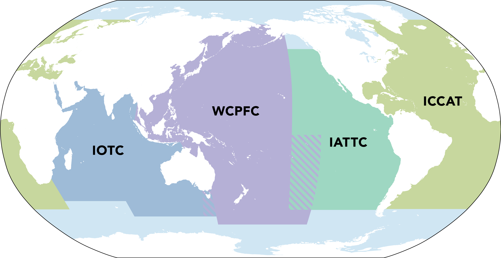
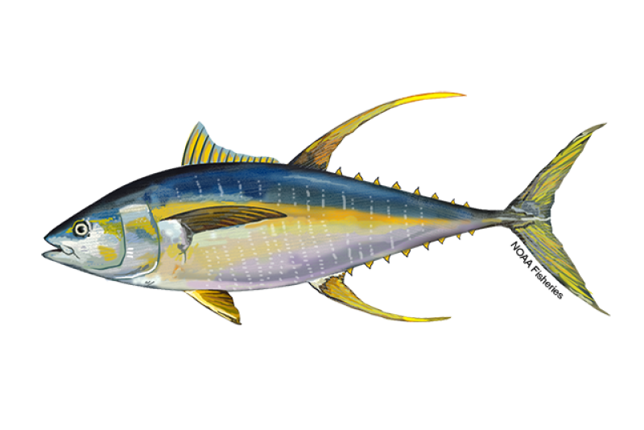
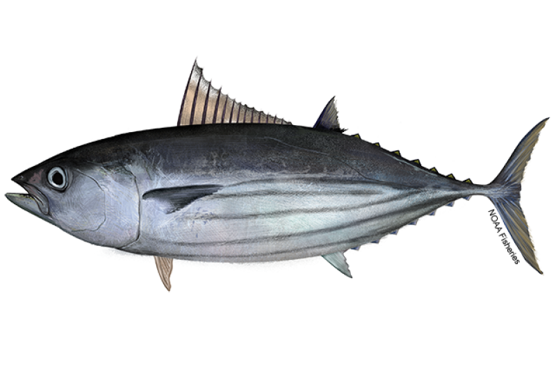
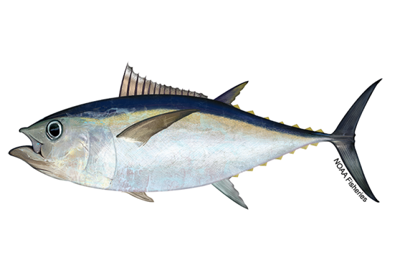
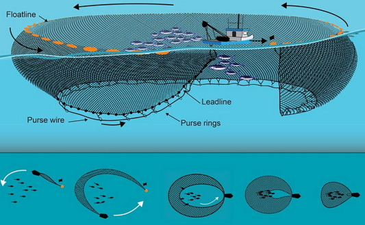

---
format:
  html:
    embed-resources: true
    include-in-header:
      text: |
        <script src="https://d3js.org/d3.v7.min.js"></script>
lightbox: true
page-layout: full
---
::: {.hero}

<div class="hero-image"></div>

<div class="hero-content">

# Who is caught with your tuna?

## A science communication project exploring trends of shark bycatch in the Eastern Pacific Ocean tuna purse seine fishery
*Photo credit*: Save Our Seas\
*Data credit*: Inter-American Tropical Tuna Comission (IATTC) public domain data

</div>

:::
\

This Github Pages project uses IATTC public domain data to explore trends in shark bycatch while showcasing reproducible scientific communication tools. To prioritize maximum reproducability, I am predominantly using R packages, as this is the coding language most environmental researchers are familiar with already. Some of the code has some javascript sprinkled in for aesthetics and to showcase how R and javascript can work in tandem to create aesthetic plots, but I try to keep this to a minimum so the code doesn't get too complicated! For a javascript-heavy interactive figure, check out the [Fun with javascript](https://isabellagarfield.github.io/SciCom_project/content/test.html) page. 

Tools used:
- *Quarto tool:* [Lightbox](https://quarto.org/docs/output-formats/html-lightbox-figures.html) - click images for slideshow!
- *R packages:* 
  - ggraph (tool hover)
  - [ggplotly](https://plotly.com/examples/) (another multi-function tool hover)
  - gganimate (generating gifs)


## Background

Most of us have come across tuna in one form or another, whether it was the bright on layered poke bowls, or the nondescript brown spread on a tuna melt sandwhich or casserole, or even the miscellaneous mush we feed our cats. But less frequently do we think about where that tuna comes from, and the ecological cost of commercializing this product.  

Tuna are high-seas fish that can routinley cross entire ocean basins during migratory journeys. They are found across the equatorial Atlantic, Pacific, and Indian oceans, and the northern extent of the southern ocean. The most economically important tuna species include Skipjack (primarily used for canning), Yellowfin (versetile sushi and sashimi), and Bluefin tuna (high-value sushi and sashimi). Because tuna are predominantly captured outside the jurisdiction of national waters, they are managed by Fisheries Regional Management Organizations (RFMOs), which are structured as international mangement bodies that regulate multiple member nations. RFMO jurisdiction typically spans entire ocean basins (ex. ICCAT manages tuna fisheries in the Atlantic ocean). The Pacific ocean is split between the Western and Central Pacific Fisheries Comission (WCPFC) and the Inter-American Tropical Tuna Comission (IATTC).

Across fisheries, but particularly in tuna fisheries, bycatch - or incidental catch of non-target species - represents a key sustainability issue. Dolphins, sharks, and rays are among the groups frequently caught alongside target tuna species. Regional Fisheries Management Organizations (RFMOs) are responsible for sustainably managing both target tuna stocks and the non-target species impacted by fishing activities. As part of its efforts to increase transparency around fishing impacts, the Inter-American Tropical Tuna Commission (IATTC) makes observer-collected bycatch data publicly available. This project explores shark bycatch patterns using IATTC observer data, which are collected under 100% observer coverage requirements for the region's largest purse seine vessels.



## Eastern Pacific Tuna fishery (IATTC)

The eastern Pacific Ocean catches roughly 700,000 metric tons of tuna annually. The most important species of tuna in this region include Skipjack tuna, Yellowfin tuna, and Bigeye tuna. 

::: {layout-ncol=3}

{.lightbox group="tuna" width=100%}

{.lightbox group="tuna" width=100%}

{.lightbox group="tuna" width=100%}

:::

::: {.columns .tuna-description}

::: {.column width="60%"}
To catch tuna on this scale, commercial fisheries operating in this region rely on a highly efficient fishing gear known as a purse seine net. This method uses large vessels equipped with expansive nets that are deployed to encircle an entire school of tuna. The bottom of the net is then drawn closed, much like a drawstring purse, trapping the fish inside before the catch is brought on board. Unlike pole-and-line or longline fisheries, which generally target individual fish, purse seine fisheries can capture large numbers of tuna in a single set.

:::

::: {.column width="40%"}

{fig-alt="Diagram illustrating how a purse seine net encircles a school of tuna"}

:::
:::

This fishery has roughly ten actively participating countries. Ecuador catches the largest quantity of tuna, and the largest proportion of Bigeye and Skipjack tuna of all member countries. However, Mexico catches the largest proportion of Yellowfin tuna, largely due to closer proximity to the Costa Rica Dome (see [Dolphin Sets](http://localhost:7860/#dolphin-sets) for more context). 

```{r}
#| echo: false
#| message: false
#| warning: false

library(ggiraph) # install.packages('ggiraph')
library(ggplot2) # install.packages('ggplot2')
library(dplyr) # install.packages('dplyr')
library(patchwork) # install.packages('patchwork')
library(tidyr) # install.packages('tidyr')
library(sf) # install.packages('sf')
library(tidyverse)
set.seed(123)

data.2 <- read_csv("Data/Tuna/IATTC_flag.csv") 
  
# Create lookup table
flag_lookup <- tribble(
  ~BanderaFlag,       ~Country,
  "CHL",         "Chile",
  "USA",         "United States of America",
  "JPN",         "Japan",
  "PER",         "Peru",
  "COL",         "Colombia",
  "ECU",         "Ecuador",
  "MEX",         "Mexico",
  "PAN",         "Panama",
  "CAN",         "Canada",
  "TWN",         "Taiwan",
  "ESP",         "Spain",
  "CRI",         "Costa Rica",
  "NLD",         "Netherlands",
  "BMU",         "Bermuda",
  "KOR",         "South Korea",
  "SEN",         "Senegal",
  "VEN",         "Venezuela",
  "CYM",         "Cayman Islands",
  "VUT",         "Vanuatu",
  "PYF",         "French Polynesia",
  "GTM",         "Guatemala",
  "BLZ",         "Belize",
  "CHN",         "China",
  "SLV",         "El Salvador",
  "FRA (PYF)",   "French Polynesia",
  "EU (ESP)",    "Spain",
  "HND",         "Honduras",
  "NIC",         "Nicaragua"
)

# Remove UNK and add full country names
data.2_filt <- data.2 %>%
  filter(BanderaFlag != "UNK") %>%
  filter(BanderaFlag != "OTR") %>%
  filter(BanderaFlag != "GTM") %>%
  left_join(flag_lookup, by = "BanderaFlag") %>%
  filter(ArteGear == "PS") %>%
  filter(AnoYear > 2005) 

# Summarize total catch by country AND year (for time series)
year_country <- data.2_filt %>%
  filter(!is.na(Country)) %>%
  group_by(Country, AnoYear) %>%
  summarise(t = sum(t, na.rm = TRUE), .groups = "drop")

# Summarize total catch by country across all years (for bar chart and map)
country_totals <- year_country %>%
  group_by(Country) %>%
  summarise(total_t = sum(t, na.rm = TRUE), .groups = "drop")

# Create one consistent color palette for all countries
countries <- sort(unique(country_totals$Country))

country_colors <- setNames(
  scales::hue_pal()(length(countries)),
  countries)

# Read and filter world map
world_base <- read_sf(
  "https://raw.githubusercontent.com/holtzy/R-graph-gallery/master/DATA/world.geojson"
) %>%
  filter(!name %in% c("Antarctica", "Greenland"))

# Join country totals to map (one row per country)
world_sf <- world_base %>%
  left_join(country_totals, by = c("name" = "Country"))

#Tuna metric ton bar chart
bar_data <- country_totals %>%
  mutate(Country = reorder(Country, total_t))

p1 <- ggplot(bar_data, aes(x = Country, y = total_t, 
                           tooltip = Country, #This pops up the country name when mouse hovers
                           data_id = Country, #This connects the countries across the interactive plot
                           fill = Country)) +
  geom_col_interactive() +
  coord_flip() +
  scale_fill_manual(values = country_colors) +
  scale_y_continuous(labels = scales::comma) +
  theme_minimal() +
  theme(
  axis.title.y = element_blank(),
  axis.title.x = element_text(),
  legend.position = "none"
) +
labs(y = "Total tuna (metric tons)") #Because we used coord_flip earlier, this is technically the y axis, not the x axis


#p3 tuna species plot
data.2_species <- data.2_filt %>%
  group_by(EspeciesSpecies, Country) %>%
  summarize(t = sum(t)) %>%
  filter(EspeciesSpecies %in% c("BET", "YFT", "SKJ")) #BET = Bigeye tuna, YFT = Yellowfin tuna, SKJ = Skipjack tuna

p2 <- ggplot(
  data.2_species,
  aes(
    x = EspeciesSpecies,
    y = t, #tons of tuna
    fill = Country,
    group = Country,
    tooltip = Country, #Pop up country name
    data_id = Country #connecting the country data across the figures
    )) +
  geom_col_interactive(position = "fill") +
  scale_color_manual(values = country_colors) +
  scale_y_continuous(labels = scales::comma) +
  theme_classic() +
  theme(legend.position = "none") +
  labs(x = "Year", y = "Total", color = "Country")

# Create the third chart (map)
world_sf <- world_sf %>%
  left_join(data.2_filt, by = c("name" = "Country"))

p3 <- ggplot() +
  geom_sf(data = world_sf, fill = "lightgrey", color = "lightgrey") + #adding the map layer
  geom_sf_interactive(data = filter(world_sf, !is.na(total_t)), #eliminating countries with NA values
                      aes(fill = name, tooltip = name, data_id = name)) +
  scale_fill_manual(values = country_colors) + #adding the country color pallet defined above
  coord_sf(crs = st_crs(3857)) + # applying the WGS 84 projection, standard for full world map
  theme_void() + #theme cleans up final fig
  theme(legend.position = "none") #GET RID OF THAT LEGEND BLEH

# Combine the plots
combined_plot <- (p1 + p2) / p3 + plot_layout(heights = c(1, 2))

# Create the interactive plot
interactive_plot <- girafe(ggobj = combined_plot)

interactive_plot <- girafe_options(
  interactive_plot,
  opts_hover(css = ""), #this is where you would put a boarder around the hover (something like: stroke: black; stroke-width: 1.5px;) but the boarder on the map is a bit clunky
  opts_hover_inv(css = "fill: lightgrey; stroke: white;")
)
# Display the interactive plot
interactive_plot
```


Tuna purse seines in this region use three primary types of catch methods. 

#### Object sets
Object sets refer to any time tuna are encircled around a floating object, whether it is a specially-manufactured floating object device or simply opportunistically-found floating logs. This method has become the most popular set-type used in the fishery largely due to advanced gps and remote fish-finder technology that allow fishers to see the tuna composition on their floating objects before they transit to it. 

#### Dolphin sets
The eastern Pacific ocean is the only place in the world where tuna and dolphin co-associate, primarily in a productive region called the Costa Rica Dome. Fishers have learned to encircle a pod of dolphins to capture the school of tuna that are traveling with them, which is called a dolphin set. Fishers employ a 'backdown method' to release dolphins at one end of the net while still retaining the tuna. Historically, many dolphins died during this process, but sustainable practices and gear were developed after public pressure in the early 2000s that reduced dolphin mortality to near-zero levels. 

#### Free school sets
The third method is a 'free-school set', which refers to when fishers find a free-swimming school of tuna. Often, fishers will use bird radar to find feeding frenzies at sea, which typically indicates the presence of tuna schools. 

Below is a figure showing the change in set type use by the eastern Pacific purse seine fishery, showing the growth in object set use over time. 

```{r}
#| echo: false
#| message: false
#| warning: false

library(tidyverse)
library(plotly)

set_colors <- c("Object sets" = "#0072B2", "Non-associated sets" = "#D55E00", "Dolphin sets" = "#009E73") # using this to keep set-type colors consistent for the next two figures

# Load your data
data <- read_csv("Data/Mobulid/sum_set_year.csv")


# Create figure
p <- ggplot(data, aes(x = Year)) +
  geom_line(aes(y = OBJ, color = "Object sets")) +
  geom_line(aes(y = NOA, color = "Non-associated sets")) +
  geom_line(aes(y = DEL, color = "Dolphin sets")) +
  scale_color_manual(values = set_colors) +
  labs(
    title = "Trends of set-type use in the EPO tuna purse seine fishery",
    x = "Year",
    y = "Number of Sets",
    color = "Set Type"
  ) +
  theme_classic()

ggplotly(p)
```

\
\

Set types have different spatial use. For example, object sets are typically used further offshore, dolphin sets are primarily used north of the equator around the Costa Rica Dome, and Non-associated sets are typically used further inshore. Additionally, the tuna themselves are captured in slightly different spaces, with more skipjack tuna captured south, yellowfin primarily captured north, and bigeye captured further offshore. You can see some of these trends in the figure below. 

```{r}
#| echo: false
#| message: false
#| warning: false
#| fig-width: 10
#| fig-height: 5
#| out-width: 100%

library(tidyverse)
library(ggiraph)
library(maps)

tuna <- read_csv("Data/Tuna/PublicPSTunaSetType.csv") %>% 
  filter(Year > 2020)
  
#Have to pivot df long to plot multiple species on the same figure

# Pivot dataframe to long format
tuna_long <- tuna %>%
  pivot_longer(
    cols = c(YFT, SKJ, BET),
    names_to = "Species",
    values_to = "Catch"
  ) %>%
  filter(
    !is.na(Catch),
    Catch > 0,
    !is.na(LatC1),
    !is.na(LonC1)
  ) %>%
  mutate(
    Species = recode(
      Species,
      "YFT" = "Yellowfin tuna",
      "SKJ" = "Skipjack tuna",
      "BET" = "Bigeye tuna"
    ),
    SetType = factor(SetType, levels = c("OBJ", "DEL", "NOA"))
  ) %>%
  arrange(SetType)


tuna_map <- ggplot() +
  geom_polygon(data = map_data("world"), aes(x = long, y = lat, group = group), fill = "lightgrey", color = "white") +
  geom_point_interactive( #This is essentially the same as coding with geom_point, the _interactive function allows the tooltip to create a hover pop-up
    data = tuna_long,
    aes(x = LonC1, y = LatC1, color = SetType, alpha = Catch,
      tooltip = paste0( #This is the interactive hover portion of the code. This will set the following information when the mouse hovers over a data point (these variables are all separate columns in the df:
        "\nCatch: ", scales::comma(Catch), " mt", # display MT of tuna captured
         "\nSet Type: ", SetType), # Display set type
      data_id = Species), size = 0.3) +
  facet_wrap(~Species) + #creating three separate plots per species
 scale_color_manual(
  values = c("NOA" = unname(set_colors["Non-associated sets"]), "OBJ" = unname(set_colors["Object sets"]), "DEL" = unname(set_colors["Dolphin sets"])), #linking the set-type color specific assignment from previous code chunk
  labels = c("NOA" = "Non-associated", "OBJ" = "Object", "DEL" = "Dolphin"), name = "Set Type") + #Explicitly relabeling for figure output
  coord_fixed(xlim = c(-155, -60), ylim = c(-30, 35), expand = FALSE) + #x y boundaries, expand = false removes extra white space around figure boundaires
  theme_classic() + #theme_classic because it eliminates the axis lines extending across the plot
  guides(color = guide_legend(override.aes = list(size = 3, alpha = 1))) + #Making the legend points bigger than the plotted point size
  labs(title = "Distribution of tuna catch by species, set type, and metric tons (ggiraph)", x = "Longitude", y = "Latitude", color = "SetType") + #axis labels
  scale_alpha(guide = "none") #Gets rid of the catch alpha legend
#now to animate with the interactive hover!
girafe(ggobj = tuna_map, 
       width_svg = 10, height_svg = 4.5, width = 1, height = 0.45, #This is just to reduce figure spacing display in quarto
       options = list(opts_hover(css = "stroke:black;stroke-width:1px;"), opts_tooltip(opacity = 0.9))) #Animation line connecting the tooltip code from the ggplot above
```


## Bycatch

Tuna purse seine fisheries don't just catch tuna - sharks and rays represent key bycatch species that are often caught incidentally. Silky sharks make up 90% of all bycatch in the eastern Pacific purse seine fishery. Shark bycatch has increased with the use of object sets, because sharks are attracted to the fish that aggregate around floating objects for shelter. 

```{r}
#| echo: false
#| message: false
#| warning: false

shark_dat <- read_csv("Data/Shark/PublicPSSharkFlag.csv") 

library(tidyverse)
library(lubridate)
library(ggiraph)
library(hrbrthemes)

shark_species <- c(
  "FALn", "BSHn", "CCLn", "OCSn", "SEPNn",
  "SKHn", "SPLn", "SPNn", "SPZn", "THRn"
)

# Pivot species while retaining the original set-level coordinates
shark_long <- shark_dat %>%
  mutate(
    Date = make_date(Year, Month, 1),
    Year = as.integer(Year)
  ) %>%
  pivot_longer(
    cols = all_of(shark_species),
    names_to = "Species",
    values_to = "Captures"
  ) %>%
  mutate(
    Species = recode(
      Species,
      "FALn" = "Silky shark",
      "BSHn" = "Blue shark",
      "CCLn" = "Blacktip shark",
      "OCSn" = "Oceanic whitetip shark",
      "SEPNn" = "Pelagic thresher shark",
      "SKHn" = "Shortfin mako",
      "SPLn" = "Scalloped hammerhead",
      "SPNn" = "Smooth hammerhead",
      "SPZn" = "Great hammerhead",
      "THRn" = "Thresher shark"
    )
  )

# Identify the top 5 species by total captures
species_order <- shark_long %>%
  group_by(Species) %>%
  summarise(
    total_captures = sum(Captures, na.rm = TRUE),
    .groups = "drop"
  ) %>%
  slice_max(
    order_by = total_captures,
    n = 5,
    with_ties = FALSE
  ) %>%
  pull(Species)

# Keep only the top 5 species
shark_long <- shark_long %>%
  filter(Species %in% species_order) %>%
  mutate(
    Species = factor(Species, levels = species_order),
    Year = factor(Year, levels = sort(unique(Year)))
  )

shark_yearly <- shark_long %>%
  group_by(Year, Species) %>%
  summarise(
    Captures = sum(Captures, na.rm = TRUE),
    .groups = "drop"
  )

plot <- ggplot(
  shark_yearly,
  aes(
    x = as.numeric(as.character(Year)),
    y = Captures,
    color = Species,
    group = Species,
    tooltip = paste0(
      "Species: ", Species,
      "\nYear: ", Year,
      "\nCaptures: ", Captures
    ),
    data_id = interaction(Species, Year)
  )
) +
  geom_line_interactive(linewidth = 0.4, hover_nearest = TRUE) +
 # facet_wrap(~Species, ncol = 1) +
  scale_x_continuous(breaks = scales::breaks_width(2)) + #skip x axis labels for every two years
  scale_color_brewer(palette = "Paired") +
  theme_classic() +
  theme(legend.position = "none") +
  labs(
    x = "Year",
    y = "Number of captures",
    title = "Shark captures over time: Top 5 shark species"
  )

interactive_plot <- girafe(
  ggobj = plot,
  options = list(
    opts_hover(
      css = "stroke-width:3px; opacity:1; transition:all 0.3s ease;"
    ),
    opts_hover_inv(css = "opacity:0.15;"),
    opts_toolbar(saveaspng = FALSE)
  )
)


interactive_plot

```

```{r}
#| echo: false
#| message: false
#| warning: false

# Animate by year
library(gganimate)
library(gifski)


# Create animation
# Create animation
plot <- ggplot() +
  geom_sf(data = world_sf, fill = "lightgrey", color = "white") +
  geom_point(
    data = shark_long %>%
      filter(
        !is.na(Captures),
        Captures > 0,
        !is.na(LonC1),
        !is.na(LatC1)
      ),
    aes(x = LonC1, y = LatC1, color = Species),
    alpha = 0.3,
    size = 0.2
  ) +
  facet_wrap(~Species) +
  coord_sf(
    xlim = c(-155, -60),
    ylim = c(-30, 40),
    expand = FALSE
  ) +
  theme_ipsum() +
  labs(
    title = "Year: {current_frame}",
    x = "Longitude",
    y = "Latitude",
    color = "Shark species"
  ) +
  theme(axis.text.x = element_text(angle = 45, hjust = 1),
        legend.position = "none") +
  transition_manual(Year)

plot
animate(plot)
```

